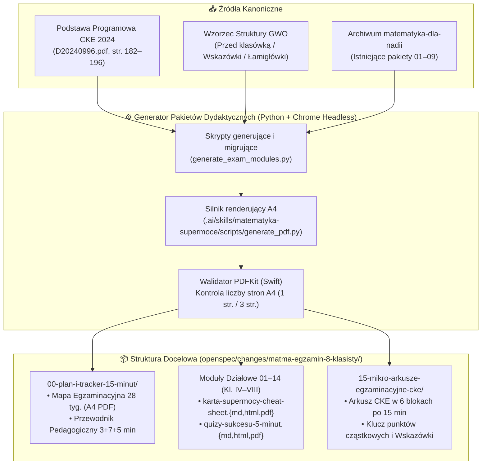

# OpenSpec Design: Architektura Dydaktyczna i Techniczna Systemu Przygotowań do Egzaminu Ósmoklasisty („Mikro-Sprinty 15 Minut”)

**Kod Zmiany**: `matma-egzamin-8-klasisty`  
**Data**: 18 Października 2026  
**Status**: Projekt Techniczny i Dydaktyczny (`design.md`)  
**Źródła Wejściowe**:
- [`proposal.md`](file:///Users/pawel/git/gen-ai-orchestrator/openspec/changes/matma-egzamin-8-klasisty/proposal.md)
- [`explore/001-matma-egzamin-8-klasisty-01.md`](file:///Users/pawel/git/gen-ai-orchestrator/openspec/changes/matma-egzamin-8-klasisty/explore/001-matma-egzamin-8-klasisty-01.md)
- [`explore/D20240996-podstawa-programowa-2024.pdf`](file:///Users/pawel/git/gen-ai-orchestrator/openspec/changes/matma-egzamin-8-klasisty/explore/D20240996-podstawa-programowa-2024.pdf) (str. 182–196)
- [`openspec/changes/archive/2026-09-12-2052-matematyka-dla-nadii`](file:///Users/pawel/git/gen-ai-orchestrator/openspec/changes/archive/2026-09-12-2052-matematyka-dla-nadii)
- Generator PDF: [`.ai/skills/matematyka-supermoce/scripts/generate_pdf.py`](file:///Users/pawel/git/gen-ai-orchestrator/.ai/skills/matematyka-supermoce/scripts/generate_pdf.py)

---

## 1. Cel i Zakres Architektury (Context & Goals)

Celem projektu jest stworzenie kompletnego, samowystarczalnego systemu materiałów do przygotowania uczennicy (Nadii) do **Egzaminu Ósmoklasisty z matematyki (CKE)** w oparciu o uszczuploną podstawę programową z 28 czerwca 2024 r. (`D20240996.pdf`, str. 182–196, pełny zakres klas IV–VI oraz VII–VIII).

### Główne założenia projektowe:
1. **Rygor czasowy 15 minut dziennie (`Formuła 3 + 7 + 5 min`)**: Każda jednostka treningowa jest zaprojektowana tak, aby mieściła się w szczytowym oknie koncentracji nastolatka (3 min Rozgrzewki Kotwicznej z *Kartą Supermocy A4* + 7 min Sprintu Zadaniowego + 5 min Audytu Detektywa i przyznania rangi).
2. **Wzorzec struktury GWO (*Matematyka z plusem*) połączony z metodyką *Matematyka Supermoce***:
   - Pobrany w fazie eksploracji podręcznik GWO stanowi wzorzec organizacji dydaktycznej (*stopniowanie trudności $\rightarrow$ zadania typu „Przed klasówką / Sprawdź, co było na egzaminie” $\rightarrow$ „W krainie łamigłówek” $\rightarrow$ jednowierszowe „Wskazówki” zamiast od razu gotowych rozwiązań*),
   - Zakres merytoryczny obejmuje wszystkie **14 działów egzaminacyjnych CKE (klasy IV–VIII)** oraz **Moduł 15 (Mikro-Arkusze Egzaminacyjne CKE)** dzielący 100-minutowy arkusz na 6 bezstresowych odcinków po 15 minut.
3. **100% Odporności Druku A4 (Zero DOCX)**: Wszystkie materiały są generowane deterministycznie w trójce formatów (`.md`, `.html`, `.pdf`) za pomocą silnika Google Chrome Headless, z automatyczną walidacją liczby stron przez macOS `PDFKit` (`PDFDocument`).

---

## 2. Przegląd Komponentów i Przepływu Danych (System Architecture & Flow)



### 2.1. Mapa Katalogów Docelowych i Strategia Migracji / Generowania

Aby uniknąć duplikacji pracy i jednocześnie wyeliminować luki z archiwalnego projektu `2026-09-12-2052-matematyka-dla-nadii` (gdzie katalogi `10`, `11`, `12` pozostały puste), przyjmujemy następującą architekturę 16 katalogów (`00`–`15`):

| Katalog docelowy w `matma-egzamin-8-klasisty/` | Źródło bazowe / Typ operacji | Zakres CKE 2024 (`D20240996.pdf`) |
| :--- | :--- | :--- |
| `00-plan-i-tracker-15-minut/` | **NOWY PAKIET** | Ramowy rozkład 28 tygodni (140 sesji po 15 min), drukowalny Tracker Postępów A4 dla uczennicy oraz Instrukcja Pedagogiczna `3 + 7 + 5 min` dla rodzica. |
| `01-liczby-i-ulamki/` | **MIGRACJA + ROZSZERZENIE** z `archive/.../01-liczby-i-ulamki` | Kl. IV–VI Dz. I–V + liczby wymierne kl. VII–VIII (Klub Przyjaciół 100/1000, Domki Pozycyjne, Strażnik Zera, okresy, znaki rzymskie, podzielność). |
| `02-potegi-i-notacja-wykladnicza/` | **MIGRACJA + ROZSZERZENIE** z `archive/.../02-potegi` | Kl. VII–VIII Dz. I (prawa działań na potęgach, rozkład podstawy $6^n = 2^n\cdot 3^n$, notacja wykładnicza $a \cdot 10^k$). |
| `03-pierwiastki/` | **MIGRACJA** z `archive/.../03-pierwiastki` | Kl. VII–VIII Dz. II ($\sqrt{}$ i $\sqrt[3]{}$, szacowanie na osi, wyłączanie i włączanie czynnika pod znak pierwiastka). |
| `04-procenty/` | **MIGRACJA** z `archive/.../04-procenty` | Kl. IV–VI Dz. XII pkt 1–2 + Kl. VII–VIII Dz. V (3 typy obliczeń %, dwukrotne podwyżki/obniżki, punkty procentowe). |
| `05-wyrazenia-algebraiczne/` | **MIGRACJA** z `archive/.../05-wyrazenia-algebraiczne` | Kl. IV–VI Dz. VI pkt 1–2 + Kl. VII–VIII Dz. III–IV (redukcja wyrazów podobnych, mnożenie sumy przez jednomian i dwumianu przez dwumian, dowody podzielności). |
| `06-rownania-i-wzory/` | **MIGRACJA + ROZSZERZENIE** z `archive/.../06-rownania` | Kl. IV–VI Dz. VI pkt 3 + Kl. VII–VIII Dz. VI (równania 1. stopnia, sprawdzanie równań st. 1–3, przekształcanie wzorów geometrycznych i fizycznych). |
| `07-trojkaty-katy-pitagoras-i-dowody/` | **MIGRACJA + ROZSZERZENIE** z `archive/.../07-trojkaty-katy-pitagoras` | Kl. IV–VI Dz. VII–IX + Kl. VII–VIII Dz. VIII (kąty na prostych równoległych, przystawanie trójkątów, twierdzenie Pitagorasa, proste dowody geometryczne). |
| `08-czworokaty-i-pola/` | **MIGRACJA** z `archive/.../08-czworokaty-i-pola` | Kl. IV–VI Dz. IX i XI + Kl. VII–VIII Dz. IX (pola wielokątów, wyznaczanie wysokości ze wzoru na pole, zamiana jednostek pola z $\text{a}$ i $\text{ha}$). |
| `09-uklad-wspolrzednych/` | **MIGRACJA** z `archive/.../09-uklad-wspolrzednych` | Kl. VII–VIII Dz. X (oś liczbowa, punkty kratowe, środek odcinka, drugi koniec odcinka, długość odcinka z Pitagorasa, punkty kratowe na prostej $AB$). |
| `10-geometria-przestrzenna/` | **NOWY PAKIET** *(wypełnienie pustego folderu `10` z archiwum)* | Kl. IV–VI Dz. X–XI + Kl. VII–VIII Dz. XI (graniastosłupy i ostrosłupy proste/prawidłowe i nieprawidłowe, siatki, pole powierzchni i objętość z Pitagorasem, litry i $\text{dm}^3$). |
| `11-rachunek-prawdopodobienstwa-i-statystyka/` | **NOWY PAKIET** *(wypełnienie pustego folderu `11` z archiwum)* | Kl. IV–VI Dz. XIII + Kl. VII–VIII Dz. XII–XIII (tabele, diagramy słupkowe/kołowe, wykresy, średnia arytmetyczna, zliczanie obiektów, prawdopodobieństwo klasyczne). |
| `12-zadania-tekstowe-predkosc-droga-czas-skala/` | **NOWY PAKIET** *(wypełnienie pustego folderu `12` z archiwum)* | Kl. IV–VI Dz. XII pkt 3–9 + Kl. VII–VIII Dz. VII (proporcjonalność prosta, podział proporcjonalny, $s=v\cdot t$, zamiana $\text{km/h} \leftrightarrow \text{m/s}$, zegar, kalendarz, skala mapy). |
| `13-okrag-i-kolo-liczba-pi/` | **NOWY PAKIET** *(dedykowany pod Dział XIV kl. VII–VIII)* | Kl. IV–VI Dz. IX pkt 6–7 + Kl. VII–VIII Dz. XIV (długość okręgu $L=2\pi r$, pole koła $P=\pi r^2$, wyznaczanie promienia i średnicy, figury złożone z półkoli). |
| `14-dowodzenie-i-zadania-otwarte-cke/` | **NOWY PAKIET** *(dedykowany pod Cel IV CKE i sekcję „Przed klasówką”)* | Strategie rozwiązywania zadań otwartych CKE (2–4 pkt), szablon dowodu algebraicznego (podzielność) i geometrycznego (kąty/przystawanie) + system *Wskazówek GWO*. |
| `15-mikro-arkusze-egzaminacyjne-cke/` | **NOWY PAKIET** *(trening finałowy 6 $\times$ 15 min)* | Pełny wzorcowy arkusz Egzaminu Ósmoklasisty CKE podzielony na **6 odcinków po 15 minut** (Dni 1–6) wraz z kartą *Wskazówek* i kluczem punktacji cząstkowej CKE. |

> **Dlaczego zachowujemy numery `01`–`12` zgodne z konwencją `matematyka-dla-nadii` i dodajemy `00`, `13`, `14`, `15`?**
> Dzięki temu w 100% zachowujemy kompatybilność wsteczną z tabelą ze skilla [`matematyka-supermoce/SKILL.md`](file:///Users/pawel/git/gen-ai-orchestrator/.agents/skills/matematyka-supermoce/SKILL.md#L113-L131) oraz istniejącymi kartami `01`–`09`, uzupełniając puste wcześniej katalogi `10`, `11`, `12` i domykając pełną podstawę programową CKE 2024 modułami `13` (Koło i okrąg z $\pi$), `14` (Dowodzenie i zadania otwarte) oraz `15` (Mikro-arkusze CKE 6 $\times$ 15 min).

---

## 3. Kontrakty Artefaktów i Schematy Danych (Artifact Contracts & Print Schemas)

### 3.1. Kontrakt Katalogu Modułu (`01`–`14`)
Każdy katalog modułu `NN-nazwa-dzialu/` **MUSI** zawierać komplet 6 plików:
1. `karta-supermocy-cheat-sheet.md` – źródło Markdown z 4–5 modułami kotwicznymi (*Złota Tabela Sprytu*, *Schemat Wizualny*, *Antypułapki CKE*, *Szacowanie w 3 sekundy*).
2. `karta-supermocy-cheat-sheet.html` – szablon HTML/CSS zoptymalizowany pod **dokładnie 1 stronę A4 portrait**.
3. `karta-supermocy-cheat-sheet.pdf` – wyrenderowany plik PDF (walidowany programowo: `pageCount == 1`).
4. `quizy-sukcesu-5-minut.md` – źródło Markdown zawierające 4 karty 5-minutowe (Karta 1–4, po 3 zadania = 6 pkt na kartę) + Klucz odpowiedzi + Wskazówki w stylu GWO + Wskazówki coachingowe dla rodzica.
5. `quizy-sukcesu-5-minut.html` – szablon HTML/CSS z podziałem `page-break-after: always`:
   - **Strona 1 A4**: Karta 1 (Wtorek) i Karta 2 (Środa),
   - **Strona 2 A4**: Karta 3 (Piątek – ze Spiralą Pamięci) i Karta 4 (Sobota / Boss),
   - **Strona 3 A4**: Wskazówki naprowadzające (styl GWO) + Pełny Klucz Odpowiedzi Krok po Kroku + Wskazówki Coachingowe dla Rodzica.
6. `quizy-sukcesu-5-minut.pdf` – wyrenderowany plik PDF (walidowany programowo: `pageCount == 3`).

### 3.2. Kontrakt Katalogu `00-plan-i-tracker-15-minut/`
1. `plan-przygotowan-15-minut.md` / `.html` / `.pdf` (**2 strony A4**):
   - **Strona 1 A4**: **Mapa Przygody Egzaminacyjnej (Tracker 28 Tygodni $\times$ 5 Sesji 15-Minutowych)** – wizualna plansza z polami wyboru (`[ ]`) do odhaczania każdego 15-minutowego bloku, podzielona na 4 Fazy.
   - **Strona 2 A4**: **Instrukcja Pedagogiczna dla Rodzica i Uczennicy („Rytuał 3 + 7 + 5 minut”)** + Tabela Rozkładu Tygodniowego (Tygodnie 1–28) + Zasady Bezpiecznika Anty-Stresowego.

### 3.3. Kontrakt Katalogu `15-mikro-arkusze-egzaminacyjne-cke/`
1. `mikro-arkusz-egzaminacyjny-6x15min.md` / `.html` / `.pdf`:
   - Kompletny arkusz egzaminacyjny (15 zadań zamkniętych + 6 zadań otwartych, łącznie 45 pkt wg standardu CKE) podzielony graficznie na **6 dziennych odcinków po 15 minut (Odcinek 1–6)**, tak aby dziecko nigdy nie musiało widzieć przed sobą przytłaczającego 20-stronicowego zeszytu egzaminacyjnego naraz!
2. `klucz-i-wskazowki-mikro-arkusza.md` / `.html` / `.pdf`:
   - Dwustopniowy system pomocy wzorowany na podręcznikach GWO:
     - **Poziom 1 (Wskazówka Detektywa – zanim spojrzysz do rozwiązania)**: 1 zdanie naprowadzające,
     - **Poziom 2 (Rozwiązanie za punkty CKE)**: Rozpisanie każdego punktu cząstkowego (za co egzaminator CKE daje 1 pkt, 2 pkt, 3 pkt).

### 3.4. Wymagania Techniczne CSS dla Druku A4
```css
@page {
  size: A4 portrait;
  margin: 8mm 10mm 8mm 10mm;
}
* {
  box-sizing: border-box;
  -webkit-print-color-adjust: exact;
  print-color-adjust: exact;
}
.page-break {
  page-break-after: always;
  break-after: page;
}
```

---

## 4. Wybory Architektoniczne i Trade-offy (Architectural Trade-offs)

| Decyzja projektowa | Wybrany wariant | Alternatywa | Uzasadnienie i Trade-offy |
| :--- | :--- | :--- | :--- |
| **Struktura numeracji folderów (`00`–`15`)** | Zachowanie numeracji `01`–`12` z `matematyka-dla-nadii` + dodanie `00`, `13` (Koło $\pi$), `14` (Dowody/Otwarte), `15` (Mikro-Arkusze) | Całkowita zmiana numeracji `01`–`14` wg chronologii klas IV–VIII | **Zysk:** 100% spójności z istniejącym skillem `matematyka-supermoce` i wygenerowanymi już kartami `01`–`09`, brak konieczności przepisywania działających arkuszy. Kolejność chronologiczną (Tygodnie 1–28) definiuje *Mapa Przygody* w katalogu `00-plan-i-tracker-15-minut/`. |
| **Format wyjściowy materiałów** | Trójka: `.md` + `.html` + `.pdf` (przez Chrome Headless) | Generowanie plików `.docx` / LaTeX | **Zysk:** Zgodność z twardym zakazem DOCX ze skilla `matematyka-supermoce`; HTML+CSS daje pełną kontrolę nad kolorowymi kartami kotwicznymi i siatką 1x A4, a Chrome Headless renderuje identyczny PDF na każdym urządzeniu. |
| **Sposób pracy z arkuszem CKE** | Dekompozycja arkusza na **6 odcinków po 15 minut** (`Moduł 15`) | Rozwiązywanie pełnego arkusza 100-minutowego w weekend | **Zysk:** Zgodność z głównym założeniem użytkownika (praca w codziennych 15-minutowych blokach). Chroni dziecko przed paraliżem egzaminacyjnym, budując jednocześnie pełną biegłość we wszystkich 21 zadaniach arkusza. |

---

## 5. Obsługa Sytuacji Awaryjnych i Krawędziowych (Edge Cases & Error Handling)

1. **Przepełnienie strony A4 w PDF (`Page Overflow > 1` dla Karty Supermocy lub `> 3` dla Quizów)**:
   - *Ryzyko techniczne*: Zbyt duża czcionka lub zbyt wysokie marginesy w HTML powodują powstanie pustej lub częściowo zapisanej 2. strony w Karcie Supermocy.
   - *Mechanizm obronny*: Skrypt weryfikujący w Swift (`PDFDocument(url:).pageCount`) sprawdza każdy wygenerowany plik PDF. Jeśli `karta-supermocy-cheat-sheet.pdf` ma $\neq 1$ stronę lub `quizy-sukcesu-5-minut.pdf` ma $\neq 3$ strony, walidator zgłasza błąd i korygujemy `font-size` / `padding` w CSS przed zatwierdzeniem zadania.
2. **Blokada poznawcza dziecka podczas 7-minutowego Sprintu Zadaniowego**:
   - *Ryzyko pedagogiczne*: Dziecko napotyka w czwartek zadanie otwarte CKE za 3 pkt i mówi *„Nie umiem tego, poddaję się”*.
   - *Mechanizm obronny (Protokół 2-Stopniowej Pomocy GWO)*:
     1. Najpierw sięgamy po **Kartę Supermocy A4** leżącą na biurku (*„W którym boksie na karcie jest podobny rysunek?”*).
     2. Jeśli to nie wystarczy, rodzic czyta **jednowierszową Wskazówkę Detektywa** (wzorowaną na dziale *Wskazówki* ze str. 277–279 podręcznika GWO), która zdradza tylko **pierwszy mikro-krok** (np. *„Oblicz najpierw z trójki 5-12-13 wysokość trójkąta”*), zostawiając dziecku satysfakcję z samodzielnego dokończenia zadania.
3. **Przerwa w ciągłości (choroba / wyjazd / ciężki tydzień w szkole)**:
   - *Zasada nienaruszalna*: Nigdy nie łączymy dwóch lub trzech zaległych 15-minutówek w 30–45 minut pracy. Tracker w `00-plan-i-tracker-15-minut/` opiera się na numerach sesji (`Sesja #1` do `Sesja #140`), a nie na sztywnych datach kalendarzowych – po przerwie po prostu odhaczamy kolejną kratkę.
