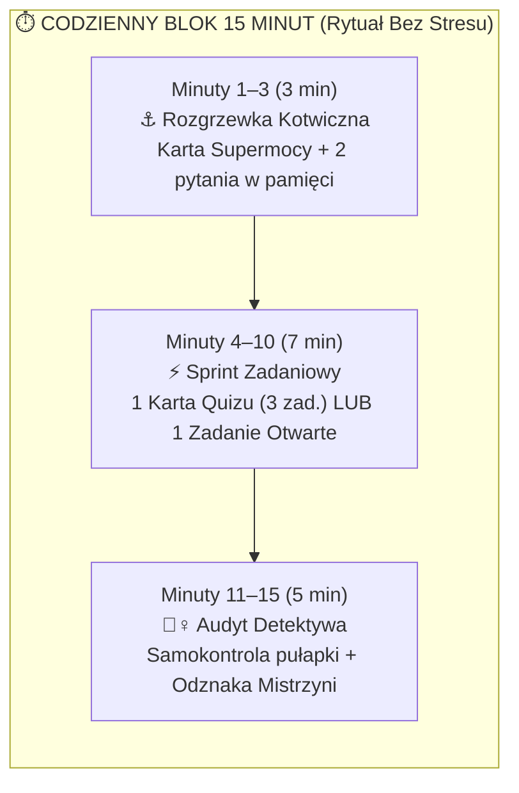

# 001: Eksploracja Pedagogiczna i Mapowanie Podstawy Programowej CKE (2024) na System Codziennych 15-Minutowych Bloków

- **Kod zmiany:** `matma-egzamin-8-klasisty`
- **Data eksploracji:** 2026-10-18
- **Rola prowadzącego:** Pedagog matematyki / trener neurodydaktyczny przygotowujący uczennicę do Egzaminu Ósmoklasisty
- **Źródła zweryfikowane empirycznie:**
  1. **Podstawa programowa (Dz.U. 2024 poz. 996, str. 182–196):** [`explore/D20240996-podstawa-programowa-2024.pdf`](file:///Users/pawel/git/gen-ai-orchestrator/openspec/changes/matma-egzamin-8-klasisty/explore/D20240996-podstawa-programowa-2024.pdf) *(Rozporządzenie Ministra Edukacji z dnia 28 czerwca 2024 r. zmieniające rozporządzenie w sprawie podstawy programowej kształcenia ogólnego dla szkoły podstawowej)*.
  2. **Podręcznik GWO Klasa 6 (284 strony, wydanie z oznaczeniem zmian 2024):** [`explore/Matematyka-z-plusem-6-Podrecznik.pdf`](file:///Users/pawel/git/gen-ai-orchestrator/openspec/changes/matma-egzamin-8-klasisty/explore/Matematyka-z-plusem-6-Podrecznik.pdf) oraz pełna warstwa tekstowa [`explore/Matematyka-z-plusem-6-Podrecznik-textual-pages.json`](file:///Users/pawel/git/gen-ai-orchestrator/openspec/changes/matma-egzamin-8-klasisty/explore/Matematyka-z-plusem-6-Podrecznik-textual-pages.json).
  3. **Archiwum wzorcowe i diagnoza Nadii:**
     - [`openspec/changes/archive/2026-09-12-2052-matematyka-dla-nadii`](file:///Users/pawel/git/gen-ai-orchestrator/openspec/changes/archive/2026-09-12-2052-matematyka-dla-nadii) (pierwowzór metodyki *Karta Supermocy A4* + *Quizy Sukcesu 5-minutowe*, pakiety `01`–`09`),
     - [`openspec/changes/archive/2026-09-30-2303-nadia-zadania-z-matematyki`](file:///Users/pawel/git/gen-ai-orchestrator/openspec/changes/archive/2026-09-30-2303-nadia-zadania-z-matematyki/README.md) (analiza kartkówki i sprawdzianu z kl. 7),
     - [`openspec/changes/archive/2026-10-04-1158-nadia-zadania-z-matematyki`](file:///Users/pawel/git/gen-ai-orchestrator/openspec/changes/archive/2026-10-04-1158-nadia-zadania-z-matematyki/README.md) (analiza zadań tekstowych 17–25).

---

## 1. Diagnoza Punktu Wyjścia i Kontekstu (Brutally Honest Audit)

### 1.1. Co wiemy na pewno (Fakty empiryczne z repozytorium)
1. **Profil poznawczy uczennicy (Nadia):**
   - Na podstawie wcześniejszych sesji (`2026-09-12`, `2026-09-30`, `2026-10-04`) wiemy, że uczennica jest w **7. klasie szkoły podstawowej** *(w roku szkolnym 2026/2027)* **[Hipoteza/Domysł: wymaga potwierdzenia, czy plan przygotowań rozpisujemy na dwuletni horyzont kl. 7–8, czy jako intensywny kurs roczny/półroczny]**.
   - Uczennica ma niską tolerancję na monotonne, długie sesje rachunkowe („słupki pod kreską”), ale **świetnie reaguje na krótkie sprinty, wizualne kotwice pamięci roboczej (*Karty Supermocy A4*) oraz sprytne skróty (*Cheat Codes / Klub Przyjaciół 100 i 1000*)**.
   - **Zdiagnozowane wcześniej punkty zapalne (z brudnopisów Nadii):**
     - Mieszanie ułamków dziesiętnych godziny z minutami ($2{,}2\text{ h}$ traktowane jako $2\text{ h } 20\text{ min}$ zamiast $2\text{ h } 12\text{ min}$),
     - Brak dopisywania „Strażnika Zera” przy pisemnym dodawaniu i odejmowaniu ułamków dziesiętnych ($25{,}7 + 2{,}94$),
     - Pomijanie ujednolicania jednostek przed startem obliczeń (np. mieszanie $\text{kg}$ z ułamkiem zwykłym lub $\text{m}$ z $\text{cm}$),
     - Dopisywanie zbędnych zer po przecinku przy zaokrąglaniu do jedności/dziesiątek ($940{,}000$ zamiast $940$).
2. **Stan zasobów podręcznikowych GWO:**
   - W pliku `proposal.md` wpisano wstępnie `Matematyka z plusem 7`, natomiast na koncie *Moje GWO* pobraliśmy kompletny podręcznik **`Matematyka z plusem 6. Multipodręcznik` (284 str., z oznaczeniem zmian 2024)**.
   - Z punktu widzenia pedagoga przygotowującego do Egzaminu Ósmoklasisty **posiadanie podręcznika klasy 6 jest ogromnym atutem**: na egzaminie CKE ok. **45–55% punktów** opiera się na fundamentach z klas IV–VI (ułamki, czas, skala, prędkość-droga-czas, pola wielokątów, kąty, procenty bazowe, proste równania i graniastosłupy). Bez załatania luk z klasy 6 nauka potęg, pierwiastków czy Pitagorasa w klasie 7–8 zawisa w próżni.
   - Jednocześnie skrypt [`download_gwo_book.py`](file:///Users/pawel/git/gen-ai-orchestrator/openspec/changes/matma-egzamin-8-klasisty/explore/download_gwo_book.py) pozwala w kilka minut pobrać analogicznie *Matematykę z plusem 7* oraz *Matematykę z plusem 8*, gdy tylko zostaną otwarte w przeglądarce.
3. **Stan materiałów w `2026-09-12-2052-matematyka-dla-nadii`:**
   - Wygenerowano już pakiety (*Karta Supermocy* + *Quizy Sukcesu 5-minutowe*) dla 9 działów (`01-liczby-i-ulamki` do `09-uklad-wspolrzednych`),
   - Katalogi `10-geometria-przestrzenna`, `11-rachunek-prawdopodobienstwa-i-statystyka` oraz `12-zadania-tekstowe-predkosc-droga-czas` są **puste (brak plików)**,
   - Brakuje dedykowanych pakietów dla **Koła i okręgu (liczba $\pi$)** (Dział XIV kl. VII–VIII w podstawie 2024) oraz **Zadań na dowodzenie i strategii egzaminacyjnych CKE**.

---

## 2. Analiza Podstawy Programowej CKE 2024 (`D20240996.pdf`, str. 182–196) – Co Obowiązuje, a Co Odpadło?

Rozporządzenie z 28 czerwca 2024 r. (obowiązujące od roku szkolnego 2024/2025 na Egzaminie Ósmoklasisty) uszczupliło podstawę programową o ok. 20% najbardziej żmudnych rachunkowo tematów. Dla ucznia pracującego w 15-minutowych blokach to kluczowa informacja – **nie tracimy ani minuty na treści wykreślone z egzaminu!**

### 2.1. Czego NIE MA na egzaminie (zielone światło na pominięcie):
1. **Dział XV (Symetrie w kl. VII–VIII – symetralna odcinka, dwusieczna kąta, środek symetrii):** Na str. 194 rozporządzenia widnieje wprost zapis: *„Dział XV podstawy programowej w zakresie przedmiotu matematyka dla klas VII i VIII może zostać zrealizowany po egzaminie ósmoklasisty.”* (Obowiązuje wyłącznie rozpoznawanie osi symetrii prostych figur z kl. IV–VI).
2. **Wzory skróconego mnożenia $(a \pm b)^2$ oraz $a^2 - b^2$:** Wykreślone ze szkoły podstawowej (w Dziale IV pkt 4 kl. VII–VIII zostało wyłącznie mnożenie dwumianu przez dwumian z redukcją wyrazów podobnych).
3. **Usuwanie niewymierności z mianownika i skomplikowane przekształcenia sum pierwiastków:** W Dziale II kl. VII–VIII zostało wyłącznie wyłączanie/włączanie czynnika pod znak pierwiastka ($\sqrt{75} = 5\sqrt{3}$) oraz mnożenie/dzielenie pierwiastków tego samego stopnia.
4. **Twierdzenie odwrotne do twierdzenia Pitagorasa:** W Dziale VIII pkt 7 kl. VII–VIII wyraźnie zaznaczono: *„zna i stosuje w sytuacjach praktycznych twierdzenie Pitagorasa (bez twierdzenia odwrotnego)”*.
5. **Wycinki kołowe i długość łuku:** W Dziale XIV kl. VII–VIII obowiązuje wyłącznie pełna długość okręgu ($L = 2\pi r$) i pełne pole koła ($P = \pi r^2$).
6. **Układy równań:** Brak w podstawie programowej SP – wszystkie zadania tekstowe rozwiązujemy za pomocą **jednego równania pierwszego stopnia z jedną niewiadomą** lub arytmetycznie.
7. **Reguła mnożenia i dodawania w kombinatoryce:** W Dziale XII pkt 1 kl. VII–VIII wyraźnie zapisano: *„w przypadkach niewymagających stosowania reguł mnożenia i dodawania”* (wystarczy wypisanie przypadków lub proste drzewko!).

---

## 3. Neurodydaktyczna Architektura Codziennych 15-Minutowych Bloków

Z perspektywy pedagoga i psychologa poznawczego: **15 minut dziennie to idealny czas dla mózgu nastolatka**, ponieważ mieści się w całości w oknie szczytowej koncentracji (*ultradial focus peak*), zanim zacznie narastać zmęczenie pamięci roboczej i kortyzol.

### 3.1. Formuła „3 + 7 + 5 minut” (Anatomia pojedynczej sesji)
1. **Minuty 1–3: Rozgrzewka Kotwiczna (3 minuty – „Rozbieg Dopaminowy”)**
   - Uczennica ma przed sobą wydrukowaną **Kartę Supermocy A4** z danego działu.
   - Rodzic/trener (lub karta samoobsługowa) zadaje 2 błyskawiczne strzały pamięciowe z tabeli kotwicznej, np.:
     - *„Jaki jest przyjaciel ósemki do tysiąca?”* ($\rightarrow 125$),
     - *„Ile minut ma $0{,}3$ godziny?”* ($\rightarrow 3 \times 6 = 18\text{ min}$).
   - **Cel pedagogiczny:** Wejście w sesję od natychmiastowego sukcesu w 15 sekund.
2. **Minuty 4–10: Główny Sprint Zadaniowy (7 minut – „Jedna Trudność Naraz”)**
   - W zależności od dnia tygodnia uczennica rozwiązuje:
     - **Wariant A (Dni 2, 3, 5):** Jedną kartę z **Quizu Sukcesu** (dokładnie 3 zadania: *1. Rozgrzewka P/F lub dobieranka*, *2. Zastosuj Supermoc*, *3. Pułapka Egzaminacyjna CKE*), LUB
     - **Wariant B (Dni 1, 4):** Jedno wyselekcjonowane zadanie z podręcznika GWO (*Przed klasówką* / *Zadanie z treścią*) rozpisane metodą **„Kroki za punkty CKE”** (Wypisz dane i ujednolić jednostki $\rightarrow$ Wybierz Ścieżkę A/B/C $\rightarrow$ Oblicz $\rightarrow$ Zapisz odpowiedź).
3. **Minuty 11–15: Audyt Detektywa i Zamknięcie (5 minut – „Efekt Szczytu i Końca”)**
   - Sprawdzenie wyniku z kluczem i – jeśli pojawił się błąd – nazwanie go językiem odciążającym emocjonalnie (nie *„znowu źle policzyłaś”*, lecz *„Oho, Strażnik Zera zaspał na drugim miejscu po przecinku!”*).
   - Zaznaczenie rangi na karcie (🏆 *Czarodziejka Matematyki*) i zamkniecie zeszytu **dokładnie po 15 minutach** – nawet jeśli uczennica ma ochotę zrobić jeszcze jedno zadanie! Pozostawienie lekkiego niedosytu sprawia, że następnego dnia mózg chętnie wraca do biurka.

### 3.2. Tygodniowy Rytm Pracy (Cykl 5 + 1 dni = 1 Mikro-Moduł Tygodniowo)

| Dzień | Typ sesji (15 min) | Materiał wejściowy | Cel pedagogiczny |
| :---: | :--- | :--- | :--- |
| **Poniedziałek** | **Fundament & Supermoc** | *Karta Supermocy A4* + 2 bazowe przykłady z podręcznika GWO (kl. 6/7) | Zrozumienie „Cheat Code’u” (Ścieżka A) i zasypanie ewentualnej luki z kl. 6. |
| **Wtorek** | **Sprint Zamknięty I** | *Quiz Sukcesu – Karta 1* (3 zadania) | Budowanie szybkości w zadaniach zamkniętych CKE (1 pkt). |
| **Środa** | **Sprint Zamknięty II** | *Quiz Sukcesu – Karta 2* (3 zadania) | Automatyzacja nawyku bez liczenia pod kreską. |
| **Czwartek** | **Misja Otwarta CKE** | 1 zadanie otwarte (2–4 pkt) z arkusza CKE / *Przed klasówką* GWO | Nauka zdobywania punktów cząstkowych CKE (rysunek, zapis równania, etap pośredni). |
| **Piątek** | **Boss Tygodnia + Spirala** | *Quiz Sukcesu – Karta 3* (2 zad. bieżące) + **1 zadanie z działu sprzed 2 tygodni** | Przeciwdziałanie krzywej zapominania Ebbinghausa (*Spaced Repetition*). |
| **Sobota** *(opcjonalnie)* | **Karta Mistrzowska / Rewanż** | *Quiz Sukcesu – Karta 4* lub rewanż z poprawioną pułapką z tygodnia | Domknięcie tygodnia ze 100% poczuciem kompetencji. |

---

## 4. Mapowanie 14 Modułów Egzaminacyjnych: CKE 2024 $\leftrightarrow$ Matematyka z plusem 6 & 7/8 $\leftrightarrow$ Pakiety Nadii

Poniższa matryca łączy pełną Podstawę Programową 2024 (`D20240996.pdf`), rozdziały pobranego podręcznika **Matematyka z plusem 6** (jako bazę naprawczą i zadaniową) oraz pakiety z `2026-09-12-2052-matematyka-dla-nadii`:

| Nr Modułu | Nazwa Modułu (Folder docelowy) | Wymagania CKE 2024 (`D20240996.pdf`) | Baza w *Matematyce z plusem 6* (Rozdział i strony) | Rozwinięcie w kl. 7–8 (CKE) | Status artefaktów z `matematyka-dla-nadii` | Czas realizacji (15 min/dzień) |
| :---: | :--- | :--- | :--- | :--- | :--- | :---: |
| **M01** | `01-liczby-naturalne-i-calkowite` | Kl. IV–VI: Dz. I (rzymskie, zaokrąglanie), Dz. II (podzielność 2,3,4,5,9,10,100; NWD/NWW; reszta), Dz. III (całkowite, wartość bezwzględna) | **Rozdz. 1** (str. 10–13), **Rozdz. 3** (Zaokrąglanie, str. 84–88), **Rozdz. 7** (Liczby dodatnie i ujemne, str. 167–180) | Działania na liczbach wymiernych dodatnich i ujemnych, oś liczbowa | Częściowo w `01` i sesji `2026-09-30` (wymaga wydzielenia cech podzielności i znaków rzymskich) | **2 tygodnie** (10–12 sesji) |
| **M02** | `02-ulamki-zwykle-i-dziesietne` | Kl. IV–VI: Dz. IV i V (zamiana, rozszerzanie, okresy, zaokrąglanie do gr/cm, wyrażenia arytmetyczne) | **Rozdz. 1** (*Liczby naturalne i ułamki*, str. 14–42) oraz *Uzupełniające zadania rachunkowe* (str. 249–264) | Złożone wyrażenia arytmetyczne z ułamkami zwykłymi i dziesiętnymi | ✅ Gotowy bazowy pakiet `01-liczby-i-ulamki` + pakiety z `2026-09-30` i `2026-10-04` | **2 tygodnie** (10–12 sesji) |
| **M03** | `03-obliczenia-praktyczne-czas-skala-jednostki` | Kl. IV–VI: Dz. XII pkt 3–8 (zegar, kalendarz, temperatura, jednostki długości i masy, skala mapy) | **Rozdz. 3** (*Liczby na co dzień*: Kalendarz i czas str. 72, Jednostki str. 75, Skala str. 80) | Zadania egzaminacyjne wieloetapowe z czasem, skalą i jednostkami kwadratowymi/sześciennymi | ⚠️ Częściowo w `2026-09-30` (wymaga pełnej Karty Supermocy „Zegar, Kalendarz, Skala i Jednostki”) | **2 tygodnie** (10–12 sesji) |
| **M04** | `04-predkosc-droga-czas-i-proporcje` | Kl. IV–VI: Dz. XII pkt 9 ($s, v, t$, $\text{km/h} \leftrightarrow \text{m/s}$); Kl. VII–VIII: Dz. VII (Proporcjonalność prosta i podział proporcjonalny) | **Rozdz. 4** (*Prędkość, droga, czas*, str. 111–126: Droga str. 112, Prędkość str. 115, Czas str. 119) | Przekształcanie wzoru $s=v\cdot t$, przelicznik $\div 3{,}6$, podział proporcjonalny (np. w stosunku $2:3$) | ❌ Pusty folder `12-zadania-tekstowe-predkosc-droga-czas` – **do wygenerowania** | **2 tygodnie** (10–12 sesji) |
| **M05** | `05-procenty` | Kl. IV–VI: Dz. XII pkt 1–2 (50%, 25%, 20%, 10%, 1%); Kl. VII–VIII: Dz. V (3 typy obliczeń %, dwukrotne podwyżki/obniżki) | **Rozdz. 6** (*Procenty*, str. 141–166: Procenty i ułamki str. 142, Jaki to procent str. 148, Obniżki i podwyżki str. 161) | Dwukrotne zmiany cen, punkty procentowe, równania z procentami, stężenia/mieszanki | ✅ Gotowy bazowy pakiet `04-procenty` (do wzbogacenia o zadania z Rozdz. 6 kl. 6) | **2 tygodnie** (10–12 sesji) |
| **M06** | `06-potegi-i-notacja-wykladnicza` | Kl. VII–VIII: Dz. I (Potęgi o podstawach wymiernych, prawa działań na potęgach, notacja wykładnicza $a \cdot 10^k$) | **Rozdz. 1** (*Potęgowanie liczb*, str. 24–26 – kwadraty i sześciany jako fundament) | Prawa potęg: $a^m \cdot a^n$, $a^m : a^n$, $(a^m)^n$, $(a\cdot b)^n$, rozkład $6^n = 2^n \cdot 3^n$, notacja $a \cdot 10^k$ | ✅ Gotowy bazowy pakiet `02-potegi` (do uzupełnienia o notację wykładniczą $a \cdot 10^k$) | **2 tygodnie** (10–12 sesji) |
| **M07** | `07-pierwiastki` | Kl. VII–VIII: Dz. II ($\sqrt{}$ i $\sqrt[3]{}$, szacowanie $a \le \sqrt{n} < a+1$, wyłączanie i włączanie pod znak pierwiastka) | Fundament w Rozdz. 1 (str. 24–26 – rozpoznawanie kwadratów i sześcianów liczb) | Wyłączanie czynnika ($\sqrt{75} = 5\sqrt{3}$), szacowanie na osi liczbowej, działania na pierwiastkach | ✅ Gotowy bazowy pakiet `03-pierwiastki` | **2 tygodnie** (10–12 sesji) |
| **M08** | `08-wyrazenia-algebraiczne` | Kl. IV–VI: Dz. VI pkt 1–2; Kl. VII–VIII: Dz. III i IV (tworzenie wyrażeń, wartość liczbowa, redukcja wyrazów podobnych, mnożenie nawiasów) | **Rozdz. 8** (*Wyrażenia algebraiczne i równania*, str. 181–196: Zapisywanie str. 182, Wartości str. 189, Upraszczanie str. 192) | Mnożenie sumy przez jednomian oraz dwumianu przez dwumian, pułapka minusa przed nawiasem | ✅ Gotowy bazowy pakiet `05-wyrazenia-algebraiczne` (do powiązania z Rozdz. 8 kl. 6) | **2 tygodnie** (10–12 sesji) |
| **M09** | `09-rownania-i-przeksztalcanie-wzorow` | Kl. IV–VI: Dz. VI pkt 3; Kl. VII–VIII: Dz. VI (sprawdzanie rozwiązania st. 1–3, równania 1. stopnia, zadania tekstowe, przekształcanie wzorów) | **Rozdz. 8** (*Zapisywanie równań* str. 197, *Liczba spełniająca równanie* str. 201, *Rozwiązywanie* str. 204, *Zadania tekstowe* str. 208–214) | Równania z ułamkami (metoda „likwidacji kresek”), przekształcanie wzorów geometrycznych i fizycznych | ✅ Gotowy bazowy pakiet `06-rownania` (do uzupełnienia o przekształcanie wzorów i sprawdzanie st. 2–3) | **2 tygodnie** (10–12 sesji) |
| **M10** | `10-katy-trojkaty-pitagoras-i-dowody` | Kl. IV–VI: Dz. VII, VIII, IX pkt 1–3, 8; Kl. VII–VIII: Dz. VIII (kąty przyległe/wierzchołkowe/odpowiadające/naprzemianległe, przystawanie, nierówność trójkąta, Pitagoras, proste dowody) | **Rozdz. 2** (*Figury na płaszczyźnie*: Proste i odcinki str. 44, Trójkąty str. 51, Kąty str. 60, Kąty w trójkątach str. 64–68) | Twierdzenie Pitagorasa (trójki 3-4-5, 5-12-13, 8-15-17), cechy przystawania trójkątów, proste dowody geometryczne | ✅ Gotowy bazowy pakiet `07-trojkaty-katy-pitagoras` (do uzupełnienia o przystawanie i dowody CKE) | **3 tygodnie** (15–18 sesji) |
| **M11** | `11-wielokaty-pola-okrąg-i-kolo` | Kl. IV–VI: Dz. IX pkt 4–7, Dz. XI pkt 1–5; Kl. VII–VIII: Dz. IX (Wielokąty foremne, pola, wysokości) oraz Dz. XIV (Długość okręgu i pole koła) | **Rozdz. 2** (Okręgi i koła str. 48, Czworokąty str. 55) oraz **Rozdz. 5** (*Pola wielokątów*, str. 127–140: prostokąt, równoległobok, romb, trójkąt, trapez) | Wyznaczanie odcinków ze wzoru na pole (np. najkrótsza wysokość trójkąta 5-12-13), długość okręgu $2\pi r$ i pole koła $\pi r^2$, jednostki $\text{a}, \text{ha}$ | ✅ Częściowo w `08-czworokaty-i-pola` (brakuje długości okręgu i pola koła z liczbą $\pi$) | **2 tygodnie** (10–12 sesji) |
| **M12** | `12-os-liczbowa-i-uklad-wspolrzednych` | Kl. VII–VIII: Dz. X (przedziały $x \ge 1{,}5$, punkty kratowe, środek odcinka, drugi koniec odcinka, długość odcinka w układzie, punkty kratowe na prostej $AB$) | Fundament osi liczbowej w **Rozdz. 1** i **Rozdz. 7** (str. 168) | Wzór na środek odcinka (średnia arytmetyczna współrzędnych), metoda „skoku wektora” na drugi koniec odcinka, Pitagoras na kratkach | ✅ Gotowy bazowy pakiet `09-uklad-wspolrzednych` (do uzupełnienia o punkty kratowe na prostej $AB$) | **1,5 tygodnia** (8–9 sesji) |
| **M13** | `13-geometria-przestrzenna-bryly` | Kl. IV–VI: Dz. X, Dz. XI pkt 6–7 (prostopadłościan, sześcian, siatki, $\text{cm}^3, \text{dm}^3, \text{l}, \text{ml}$); Kl. VII–VIII: Dz. XI (Graniastosłupy i ostrosłupy – objętość i pole powierzchni z Pitagorasem) | **Rozdz. 9** (*Figury przestrzenne*, str. 215–248: Prostopadłościany str. 216, Graniastosłupy proste str. 221, Siatki str. 224, Pole str. 226, Objętość i litry str. 228–235, Ostrosłupy str. 236–247) | Objętość $V = P_p \cdot H$ i $V = \frac{1}{3}P_p \cdot H$, użycie Pitagorasa w ścianie bocznej lub podstawie (np. wysokość ostrosłupa z krawędzi bocznej 13 i połowy boku 5 $\rightarrow 12$) | ❌ Pusty folder `10-geometria-przestrzenna` – **do wygenerowania** | **2,5 tygodnia** (12–15 sesji) |
| **M14** | `14-statystyka-kombinatoryka-prawdopodobienstwo` | Kl. IV–VI: Dz. XIII; Kl. VII–VIII: Dz. XII (zliczanie obiektów bez reguły mnożenia, rzut monetą/kostką, losowanie kuli) i Dz. XIII (diagramy słupkowe/kołowe, średnia arytmetyczna) | **Rozdz. 3** (*Odczytywanie informacji* str. 94–101, *Odczytywanie danych z wykresów* str. 102–107), **Rozdz. 6** (*Diagramy procentowe* str. 153–157) | Średnia arytmetyczna (trik z sumą elementów = średnia $\times$ liczba elementów), prawdopodobieństwo klasyczne $\frac{\text{sprzyjające}}{\text{wszystkie}}$ | ❌ Pusty folder `11-rachunek-prawdopodobienstwa-i-statystyka` – **do wygenerowania** | **2 tygodnie** (10–12 sesji) |

**Łączny wymiar pełnego kursu:** **28 tygodni** (ok. 140–160 sesji po 15 minut = cały rok szkolny od października do maja z buforem na powtórki generalne i próbne arkusze CKE rozbite na 15-minutowe odcinki!).

---

## 5. Rozważane Warianty Architektoniczne i Trade-offy

| Wariant | Opis podejścia | Zalety (Pros) | Wady / Ryzyka (Cons) |
| :--- | :--- | :--- | :--- |
| **Wariant 1 (Rekomendowany): Modułowo-Spiralny System 15-minutowy („GWO Kl. 6/7/8 + Supermoce CKE”)** | Każdy z 14 modułów posiada: (a) 1-stronicową *Kartę Supermocy A4*, (b) *4 Quizy Sukcesu po 5 minut*, (c) *Kartę Zadań z Podręcznika GWO* (wyselekcjonowane zadania z dokładnymi numerami stron z pobranego PDF) + co piątek 1 zadanie powtórkowe ze starszego działu. | - Zero przytłoczenia (stały blok 15 min), - Naturalne łatanie luk z kl. 6 przed wejściem w zadania kl. 7–8, - Odporność na zapominanie dzięki piątkowej spirali. | Wymaga konsekwentnego trzymania rytmu 4–5 razy w tygodniu i odhaczania postępów na karcie trackera. |
| **Wariant 2: Liniowe przerabianie podręczników od deski do deski** | Kolejne rozwiązywanie wszystkich tematów z podręcznika kl. 6, potem kl. 7, potem kl. 8. | Pełne pokrycie szkolne. | **Wysokie ryzyko porażki u uczennicy z krótką koncentracją:** utknięcie na miesiące w pierwszych rozdziałach, znużenie i brak czasu na działy z kl. 8 przed egzaminem. |
| **Wariant 3: Rozwiązywanie wyłącznie pełnych arkuszy egzaminacyjnych CKE (100-minutowych)** | Praca na całych arkuszach próbnych CKE. | Oswaja z formą arkusza. | **Niedopasowane poznawczo na tym etapie:** 100-minutowy arkusz z lukami w materiale kl. 7–8 budzi frustrację i poczucie bezradności zamiast pewności siebie. Pełne arkusze dzielimy na 6 mikro-odcinków po 15 minut dopiero w ostatniej fazie! |

---

## 6. Uściślenie (v2): Rola Pobranej Książki (Wzorzec Strukturalny GWO) a Pełny Zakres Kl. IV–VIII

- **Korekta akcentów:** Pobrany podręcznik *Matematyka z plusem 6* był przykładem technicznym weryfikującym możliwość ekstrakcji książek z platformy Multiteka GWO oraz wzorcem **struktury dydaktycznej podręczników GWO** (sposób stopniowania zadań, sekcje *Przed klasówką*, *W krainie łamigłówek* oraz *Wskazówki*).
- **Zakres merytoryczny planu (`proposal.md` v2):** Obejmuje **100% materiału Egzaminu Ósmoklasisty (Klasy IV–VI oraz Klasy VII–VIII)** zgodnie z rozporządzeniem `D20240996.pdf` (str. 182–196), w tym wszystkie kluczowe działy klas 7–8:
  - **Potęgi i notacja wykładnicza** (Dział I kl. VII–VIII),
  - **Pierwiastki kwadratowe i sześcienne** (Dział II kl. VII–VIII),
  - **Wyrażenia algebraiczne i mnożenie sum algebraicznych** (Działy III–IV kl. VII–VIII),
  - **Obliczenia procentowe i podwójne zmiany cen** (Dział V kl. VII–VIII),
  - **Równania 1. stopnia, sprawdzanie równań st. 1–3 i przekształcanie wzorów** (Dział VI kl. VII–VIII),
  - **Proporcjonalność prosta i podział proporcjonalny** (Dział VII kl. VII–VIII),
  - **Twierdzenie Pitagorasa, przystawanie trójkątów i dowody geometryczne** (Dział VIII kl. VII–VIII),
  - **Pola wielokątów i wyznaczanie odcinków ze wzorów na pole** (Dział IX kl. VII–VIII),
  - **Oś liczbowa i układ współrzędnych – środek i długość odcinka, punkty kratowe** (Dział X kl. VII–VIII),
  - **Geometria przestrzenna – graniastosłupy i ostrosłupy z Pitagorasem** (Dział XI kl. VII–VIII),
  - **Kombinatoryka i rachunek prawdopodobieństwa** (Dział XII kl. VII–VIII),
  - **Statystyka opisowa i średnia arytmetyczna** (Dział XIII kl. VII–VIII),
  - **Długość okręgu i pole koła z liczbą $\pi$** (Dział XIV kl. VII–VIII),
  - **Mikro-arkusze egzaminacyjne CKE (Moduł 15)** – podział pełnego 100-minutowego arkusza CKE na 6 bezstresowych odcinków po 15 minut.
