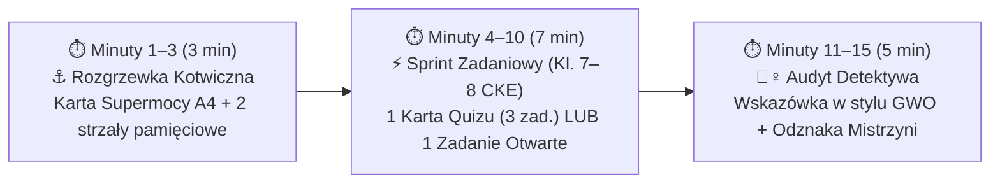

# OpenSpec Proposal: System Przygotowań do Egzaminu Ósmoklasisty z Matematyki w Codziennych 15-Minutowych Blokach („Mikro-Sprinty Supermocy CKE”)

**Kod Zmiany**: `matma-egzamin-8-klasisty`  
**Data**: 18 Października 2026  
**Status**: Propozycja (Proposal – v2: pełny zakres Egzaminu Ósmoklasisty CKE Kl. IV–VIII)  
**Rola Projektowa**: Pedagog matematyki i trener neurodydaktyczny przygotowujący dziecko do Egzaminu Ósmoklasisty CKE  

### Źródła Bazowe i Dokumenty Referencyjne:
- **Podstawa programowa (100% zakresu egzaminu: Klasy IV–VI oraz Klasy VII–VIII)**: [`https://cke.gov.pl/images/_EGZAMIN_OSMOKLASISTY/2024/komunikaty/D20240996.pdf`](https://cke.gov.pl/images/_EGZAMIN_OSMOKLASISTY/2024/komunikaty/D20240996.pdf) – strony 182–196 (kopia lokalna: [`explore/D20240996-podstawa-programowa-2024.pdf`](file:///Users/pawel/git/gen-ai-orchestrator/openspec/changes/matma-egzamin-8-klasisty/explore/D20240996-podstawa-programowa-2024.pdf))
- **Wzorzec metodyczny i neurodydaktyczny**: [`openspec/changes/archive/2026-09-12-2052-matematyka-dla-nadii`](file:///Users/pawel/git/gen-ai-orchestrator/openspec/changes/archive/2026-09-12-2052-matematyka-dla-nadii) (*Karty Supermocy A4* + *5-minutowe Quizy Sukcesu* + *Metoda Trzech Ścieżek*)
- **Wzorzec struktury podręcznika GWO**: *Matematyka z plusem* (przykładowy pobrany tom [`explore/Matematyka-z-plusem-6-Podrecznik.pdf`](file:///Users/pawel/git/gen-ai-orchestrator/openspec/changes/matma-egzamin-8-klasisty/explore/Matematyka-z-plusem-6-Podrecznik.pdf) służy jako wzorzec układu dydaktycznego serii GWO: *Wprowadzenie $\rightarrow$ Zadania stopniowane $\rightarrow$ Przed klasówką $\rightarrow$ Wskazówki krok po kroku*, natomiast zakres merytoryczny obejmuje pełny materiał egzaminacyjny ** do klasy 8 włącznie**)
- **Dokument eksploracji**: [`explore/001-matma-egzamin-8-klasisty-01.md`](file:///Users/pawel/git/gen-ai-orchestrator/openspec/changes/matma-egzamin-8-klasisty/explore/001-matma-egzamin-8-klasisty-01.md)

---

## 1. Dlaczego Ta Zmiana Jest Potrzebna? (Perspektywa Pedagoga – Problem Statement)

Egzamin Ósmoklasisty z matematyki (CKE) sprawdza skumulowaną wiedzę z **pięciu lat nauki (klasy IV–VI oraz VII–VIII)** określoną w Rozporządzeniu Ministra Edukacji z 28 czerwca 2024 r. (`D20240996.pdf`, str. 182–196). Dla ucznia, który szybko męczy się przy długich, monotonnych obliczeniach, tradycyjne przygotowania (wielogodzinne korepetycje lub rozwiązywanie całych 100-minutowych arkuszy naraz) są nieefektywne i prowadzą do przeciążenia pamięci roboczej (*cognitive overload*) oraz spadku motywacji.

Jednocześnie analiza wymagań CKE oraz dotychczasowych materiałów z [`2026-09-12-2052-matematyka-dla-nadii`](file:///Users/pawel/git/gen-ai-orchestrator/openspec/changes/archive/2026-09-12-2052-matematyka-dla-nadii) pokazuje, że:
1. **Brakuje kompletnego, przekrojowego planu (klasy IV–VIII)** rozpisującego **wszystkie działy egzaminacyjne CKE** na krótkie, **codzienne 15-minutowe bloki pracy**.
2. **Każdy dział na egzaminie CKE ma budowę dwupiętrową**:
   - *Piętro 1 (Fundament rachunkowy i pojęciowy z kl. IV–VI)* – ułamki, czas, skala, prędkość, kąty, pola prostych figur,
   - *Piętro 2 (Narzędzia egzaminacyjne z kl. VII–VIII)* – potęgi i notacja wykładnicza, pierwiastki, przekształcenia algebraiczne, równania 1. stopnia, proporcjonalność prosta, twierdzenie Pitagorasa, dowody geometryczne, długość okręgu i pole koła ($\pi$), układ współrzędnych, graniastosłupy i ostrosłupy z Pitagorasem oraz rachunek prawdopodobieństwa.
3. **W archiwum `2026-09-12-2052-matematyka-dla-nadii` brakuje części pakietów z klas VII–VIII**: foldery `10-geometria-przestrzenna` (graniastosłupy i ostrosłupy), `11-rachunek-prawdopodobienstwa-i-statystyka` oraz `12-zadania-tekstowe-predkosc-droga-czas` pozostały puste, a nowe wymagania CKE 2024 wymagają również wyodrębnienia **Koła i okręgu ($\pi$)** (Dział XIV kl. VII–VIII) oraz **Prostych dowodów geometrycznych i algebraicznych** (Dział VIII pkt 8 kl. VII–VIII).

---

## 2. Filozofia Pedagogiczna: Codzienny Blok 15-Minutowy („Formuła 3 + 7 + 5 min”)

Jako pedagog zakładam żelazną zasadę: **nigdy nie przekraczamy 15 minut w jednej sesji dziennej**. 15 minut mieści się w naturalnym oknie szczytowego skupienia nastolatka, eliminuje opór przed siadaniem do biurka (*„to tylko 15 minut”*), a przy 5 sesjach tygodniowo daje **75 minut czystej, wysoko skoncentrowanej pracy tygodniowo (~35 godzin w skali roku szkolnego)**.

### 2.1. Struktura pojedynczego 15-minutowego bloku dziennego

1. **Minuty 1–3 (3 min) – ⚓ Rozgrzewka Kotwiczna (Odciążenie Pamięci Roboczej)**:
   - Przed dzieckiem leży wydrukowana **Karta Supermocy A4** danego działu (zewnętrzna pamięć robocza).
   - 2 szybkie pytania z *Złotej Tabeli Sprytu* (np. *„Trójka pitagorejska z 5 i 12 to…?”* $\rightarrow 13$; *„$\sqrt{75}$ po wyłączeniu czynnika to…?”* $\rightarrow 5\sqrt{3}$). Gwarantowany sukces w 1. minucie.
2. **Minuty 4–10 (7 min) – ⚡ Główny Sprint Zadaniowy („Metoda Trzech Ścieżek”)**:
   - Rozwiązanie **1 Karty z 5-minutowego Quizu Sukcesu** (3 zadania: *Rozgrzewka 2 pkt + Zastosuj Supermoc 2 pkt + Pułapka Egzaminacyjna CKE 2 pkt*) **LUB** **1 zadania otwartego CKE (2–4 pkt)** prowadzonego w 3 ścieżkach do wyboru:
     - **Ścieżka A (Cheat Code / Spryt Matematyczny)** – rozwiązanie w 10–15 sekund bez żmudnych rachunków (np. podstawienie odpowiedzi w równaniu zamkniętym, rozbicie potęgi $6^8 = 2^8 \cdot 3^8$, użycie trójki pitagorejskiej 3-4-5 / 5-12-13),
     - **Ścieżka B (Klasyczny Algorytm Szkolny)** – pełny zapis krok po kroku pod klucz punktacji CKE,
     - **Ścieżka C (Wizualna / Życiowa)** – rysunek pomocniczy, metoda „woreczków” w proporcjach, skoki wektora na kratkach.
3. **Minuty 11–15 (5 min) – 🕵️‍♀️ Audyt Detektywa i „Wskazówka GWO”**:
   - Zamiast podawania od razu gotowca w razie blokady, stosujemy mechanizm wzorowany na sekcji *Wskazówki* z końca podręczników GWO (jedno naprowadzające pytanie, np. *„Zauważ, że trójkąt ma dwa kąty po 45° – jakie ma przyprostokątne?”*).
   - Sprawdzenie pułapek CKE, przyznanie rangi (🏆 *Czarodziejka / Mistrzyni*) i **sztywne zamknięcie sesji w 15. minucie**.

### 2.2. Tygodniowy Mikro-Cykl (5 dni $\times$ 15 min)
- **Poniedziałek (15 min) – Fundament + Nowa Supermoc**: Szybkie przypomnienie bazy (z kl. IV–VI) i wprowadzenie narzędzia z kl. VII–VIII na bazie *Karty Supermocy A4* (2 przykłady prowadzone).
- **Wtorek (15 min) – Sprint Zamknięty I (*Karta 1 Quizu Sukcesu*)**: 3 zadania zamknięte typu CKE (Prawda/Fałsz, wybór A–D, dobieranka).
- **Środa (15 min) – Sprint Zamknięty II (*Karta 2 Quizu Sukcesu*)**: 3 zadania o podwyższonym sprycie egzaminacyjnym (typowe pewniaki CKE z kl. 7–8).
- **Czwartek (15 min) – Misja Otwarta CKE (*Sekcja „Przed klasówką / Sprawdź, co było na egzaminie”*)**: 1 zadanie otwarte za 2–4 pkt rozpisane na **„Kroki za punkty CKE”** (uczymy dziecko, jak zdobyć 1–2 punkty cząstkowe za sam rysunek, ujednolicenie jednostek lub zapisanie równania, nawet przy trudnym zadaniu!).
- **Piątek (15 min) – Boss Tygodnia + Spirala Pamięci (*Karta 3 Quizu Sukcesu*)**: 2 zadania z bieżącego działu + **1 zadanie z działu przerabianego 2–3 tygodnie wcześniej** (*Spaced Repetition* – zapobiega zapominaniu materiału z jesieni przed majowym egzaminem).
- **Sobota (opcjonalnie 15 min) – Karta Mistrzowska (*Karta 4*) / Pogromca Pułapek**: Dodatkowy sprint utrwalający lub zagadka logiczna w stylu sekcji *W krainie łamigłówek* z GWO.

---

## 3. Higiena Programowa CKE 2024 (`D20240996.pdf`, str. 182–196): Co Obowiązuje, a Co Wycinamy?

Pełny plan obejmuje **wszystkie 14 działów klas IV–VI oraz 14 obowiązujących działów klas VII–VIII** z uszczuplonej podstawy programowej 2024. Równocześnie – jako pedagog dbający o ekonomię wysiłku dziecka – **bezwzględnie wykluczam z planu tematy usunięte lub wyłączone z Egzaminu Ósmoklasisty**:

| Zagadnienie wykluczone | Podstawa prawna w `D20240996.pdf` (str. 182–196) | Co zostaje na egzaminie? |
| :--- | :--- | :--- |
| ❌ **Dział XV kl. VII–VIII: Symetrie (symetralna odcinka, dwusieczna kąta, środek symetrii)** | Str. 194 (*Warunki i sposób realizacji*): *„Dział XV podstawy programowej (...) dla klas VII i VIII może zostać zrealizowany po egzaminie ósmoklasisty.”* | Wyłącznie rozpoznawanie osi symetrii prostych figur z kl. IV–VI (Dział IX pkt 5). |
| ❌ **Wzory skróconego mnożenia $(a\pm b)^2, a^2-b^2$** | Usunięte z Działu IV kl. VII–VIII (str. 190). | Wyłącznie mnożenie sumy przez jednomian oraz dwumianu przez dwumian z redukcją wyrazów podobnych. |
| ❌ **Usuwanie niewymierności z mianownika** | Usunięte z Działu II kl. VII–VIII (str. 189). | Wyłącznie wyłączanie i włączanie czynnika pod znak pierwiastka ($\sqrt{75}=5\sqrt{3}$) oraz mnożenie/dzielenie pierwiastków. |
| ❌ **Twierdzenie odwrotne do tw. Pitagorasa** | Str. 191, Dział VIII pkt 7: *„twierdzenie Pitagorasa (bez twierdzenia odwrotnego)”*. | Stosowanie twierdzenia Pitagorasa do obliczania boków, przekątnych i wysokości. |
| ❌ **Długość łuku i pole wycinka kołowego** | Usunięte z Działu XIV kl. VII–VIII (str. 193). | Wyłącznie pełna długość okręgu ($L=2\pi r$) i pełne pole koła ($P=\pi r^2$). |
| ❌ **Układy równań i reguła mnożenia w kombinatoryce** | Str. 190–193 (Dział VI i Dział XII pkt 1 kl. VII–VIII). | Równania 1. stopnia z 1 niewiadomą oraz zliczanie obiektów w przypadkach niewymagających reguł mnożenia i dodawania. |

---

## 4. Ramowy Plan Przygotowań – 14 Modułów Egzaminacyjnych (Klasy IV–VIII, 28 Tygodni po 15 Minut Dziennie)

Plan jest podzielony na **4 Fazy Dydaktyczne (14 Modułów)**. Każdy moduł łączy **szybki przegląd bazy (kl. IV–VI)** z **głównym treningiem egzaminacyjnym (kl. VII–VIII)**:

### FAZA I: Sprawność Rachunkowa, Ułamki, Proporcje i Procenty (Tygodnie 1–8 / 40 sesji po 15 min)
*Fundament arytmetyczny i praktyczny – ok. 35–40% punktów każdego arkusza CKE.*

1. **Moduł 01 (`01-liczby-podzielnosc-i-zbior-wymiernych`, Tygodnie 1–2 / 10 sesji)**:
   - *Zakres CKE (Kl. IV–VIII)*: Dz. I–III kl. IV–VI + operacje na liczbach wymiernych dodatnich i ujemnych w kl. VII–VIII (znaki rzymskie do 3000, cechy podzielności przez 2, 3, 4, 5, 9, 10, 100, NWD i NWW, dzielenie z resztą $a = b\cdot q + r$, liczby przeciwne, odwrotne i wartość bezwzględna).
   - *Supermoce*: „Pudełka Matrioszki ($\mathbb{N} \subset \mathbb{Z} \subset \mathbb{Q}$)” i szukanie kontrprzykładu w zadaniach P/F, cechy podzielności w 3 sekundy, oś liczbowa i termometr długów.
2. **Moduł 02 (`02-ulamki-zwykle-dziesietne-i-okresowe`, Tygodnie 3–4 / 10 sesji)**:
   - *Zakres CKE (Kl. IV–VIII)*: Dz. IV–V kl. IV–VI + złożone wyrażenia wymierne w kl. VII–VIII (zamiana ułamków, rozwinięcia dziesiętne skończone i nieskończone okresowe – wyznaczanie $n$-tej cyfry po przecinku, zaokrąglanie, szacowanie wyników).
   - *Supermoce*: **Klub Przyjaciół 10, 100 i 1000** ($4 \leftrightarrow 25$, $8 \leftrightarrow 125$), **Domki Pozycyjne i Strażnik Zera**, **Zasada Muru i Policjanta** przy zaokrąglaniu, trik reszty z dzielenia dla $n$-tej cyfry okresu. *(Wykorzystuje i rozszerza pakiet `01-liczby-i-ulamki`).*
3. **Moduł 03 (`03-procenty-podwyzki-obnizki-i-podatki`, Tygodnie 5–6 / 10 sesji)**:
   - *Zakres CKE (Kl. IV–VIII)*: Dz. XII pkt 1–2 kl. IV–VI + **Dz. V kl. VII–VIII (Pełne obliczenia procentowe)**: 3 typy zadań procentowych, **dwukrotne podwyżki i obniżki cen**, punkty procentowe vs procenty, diagramy procentowe, stężenia/mieszanki.
   - *Supermoce*: **Tabela Błyskawicznych Ułamków** ($25\%=\frac{1}{4}, 20\%=\frac{1}{5}, 10\%=\frac{1}{10}$), **Mnożnik Zmiany Ceny** (podwyżka o $15\% \rightarrow \times 1{,}15$, obniżka o $20\% \rightarrow \times 0{,}80$), Antypułapka CKE na podwójną zmianę ceny. *(Bazuje na pakiecie `04-procenty`).*
4. **Moduł 04 (`04-proporcjonalnosc-predkosc-czas-i-skala`, Tygodnie 7–8 / 10 sesji)**:
   - *Zakres CKE (Kl. IV–VIII)*: Dz. XII pkt 3–9 kl. IV–VI + **Dz. VII kl. VII–VIII (Proporcjonalność prosta i podział proporcjonalny)**: wyznaczanie wielkości wprost proporcjonalnych, **podział proporcjonalny** (np. podział kwoty w stosunku $2:3:5$), droga–prędkość–czas ($s=v\cdot t$, zamiana $\text{km/h} \leftrightarrow \text{m/s}$), zegar, kalendarz i skala mapy (w tym skala a pole powierzchni!).
   - *Supermoce*: **Metoda Woreczków (Części)** w podziale proporcjonalnym, **Złoty Przelicznik Zegara** ($0{,}1\text{ h} = 6\text{ min}$, $\frac{1}{5}\text{ h} = 12\text{ min}$), **Trójkąt $s / v \cdot t$** oraz przelicznik $\div 3{,}6$. *(Wypełnia pusty folder `12-zadania-tekstowe-predkosc-droga-czas`).*

### FAZA II: Język Klas 7–8 – Potęgi, Pierwiastki, Algebra i Równania (Tygodnie 9–16 / 40 sesji po 15 min)
*Rdzeń materiału klas VII–VIII – najwyższy zwrot punktowy przy zastosowaniu „Cheat Code’ów”.*

5. **Moduł 05 (`05-potegi-i-notacja-wykladnicza`, Tygodnie 9–10 / 10 sesji)**:
   - *Zakres CKE (Kl. VII–VIII)*: **Dz. I kl. VII–VIII** – potęgi o podstawach wymiernych i wykładnikach całkowitych dodatnich, mnożenie i dzielenie potęg o tych samych podstawach lub tych samych wykładnikach, potęgowanie potęgi, **notacja wykładnicza $a \cdot 10^k$ ($1 \le a < 10$)**.
   - *Supermoce*: **Rozbijanie Podstawy Złożonej** ($6^8 = 2^8 \cdot 3^8$), **Sprowadzanie do Wspólnej Podstawy** ($4^5 \cdot 8^2 = (2^2)^5 \cdot (2^3)^2 = 2^{16}$), **Licznik Kroków Przecinka** w notacji wykładniczej. *(Bazuje na pakiecie `02-potegi`).*
6. **Moduł 06 (`06-pierwiastki-i-szacowanie`, Tygodnie 11–12 / 10 sesji)**:
   - *Zakres CKE (Kl. VII–VIII)*: **Dz. II kl. VII–VIII** – pierwiastki kwadratowe i sześcienne, szacowanie wartości wyrażeń z pierwiastkami (np. $a \le \sqrt{137} < a+1$), porównywanie z liczbą wymierną, pierwiastek z iloczynu i ilorazu, **wyłączanie i włączanie czynnika pod znak pierwiastka**.
   - *Supermoce*: **Złota Kotwica Kwadratów ($1^2\dots 15^2$) i Sześcianów ($1^3\dots 6^3$)**, **Metoda Więzienia** ($\sqrt{75} = \sqrt{25\cdot 3} = 5\sqrt{3}$), **Kanapka Szacowania na Osi** (włącz liczbę pod pierwiastek, żeby porównać: $4\sqrt{3} = \sqrt{48} < \sqrt{49} = 7$). *(Bazuje na pakiecie `03-pierwiastki`).*
7. **Moduł 07 (`07-wyrazenia-algebraiczne-i-sumy`, Tygodnie 13–14 / 10 sesji)**:
   - *Zakres CKE (Kl. VII–VIII)*: **Dz. III i IV kl. VII–VIII** – budowanie wyrażeń z jedną i wieloma zmiennymi w zadaniach z treścią (np. zadanie o kasztanach z rozporządzenia CKE), obliczanie wartości liczbowej, porządkowanie jednomianów, dodawanie i odejmowanie sum algebraicznych, **mnożenie sumy przez jednomian oraz dwumianu przez dwumian z redukcją wyrazów podobnych**.
   - *Supermoce*: **Kolorowe Koszyki Wyrazów Podobnych**, **Alarm Minusa Przed Nawiasem**, **Metoda Czterech Strzałek (Każdy z Każdym)** przy mnożeniu $(a+b)(c+d)$ oraz **Dowody Podzielności w Algebrze** (np. wykaż, że suma trzech kolejnych liczb naturalnych $n + (n+1) + (n+2) = 3n+3 = 3(n+1)$ dzieli się przez 3). *(Bazuje na pakiecie `05-wyrazenia-algebraiczne`).*
8. **Moduł 08 (`08-rownania-zadania-tekstowe-i-wzory`, Tygodnie 15–16 / 10 sesji)**:
   - *Zakres CKE (Kl. VII–VIII)*: **Dz. VI kl. VII–VIII** – sprawdzanie czy liczba spełnia równanie stopnia 1., 2. lub 3. (np. $\frac{x^3}{8} + \frac{x^2}{2} = 0$), rozwiązywanie równań 1. stopnia metodą równań równoważnych, **zadania tekstowe z równaniem (w tym z procentami)**, **przekształcanie wzorów geometrycznych i fizycznych**.
   - *Supermoce*: **Niszczyciel Mianowników** (mnożenie obu stron przez wspólny mianownik w 1. kroku), **Trik Podstawiania Odpowiedzi** (dla równań st. 2 i 3 w zadaniach zamkniętych), **Metoda Liczby-Atrapy ($6 = 2 \cdot 3$)** przy przekształcaniu wzorów (np. wyznacz $h$ ze wzoru $P = \frac{(a+b)\cdot h}{2}$). *(Bazuje na pakiecie `06-rownania`).*

### FAZA III: Geometria Płaska i Przestrzenna Klas 7–8 (Tygodnie 17–24 / 40 sesji po 15 min)
*Od kątów i twierdzenia Pitagorasa, przez wielokąty i koło ($\pi$), układ współrzędnych, aż po graniastosłupy i ostrosłupy.*

9. **Moduł 09 (`09-katy-trojkaty-przystawanie-i-pitagoras`, Tygodnie 17–18 / 10 sesji)**:
   - *Zakres CKE (Kl. VII–VIII)*: **Dz. VIII pkt 1–7 kl. VII–VIII** (oraz Dz. VII–IX kl. IV–VI) – kąty wierzchołkowe, przyległe, odpowiadające i naprzemianległe; nierówność trójkąta ($AB + BC \ge AC$); **cechy przystawania trójkątów (BBB, BKB, KBK)**; trójkąty równoramienne i równoboczne; **twierdzenie Pitagorasa w zadaniach praktycznych** (w tym trójkąt prostokątny równoramienny $45^\circ-45^\circ-90^\circ$ z krawędzią $a\sqrt{2}$).
   - *Supermoce*: **Złote Trójki Pitagorejskie: (3, 4, 5), (5, 12, 13), (6, 8, 10), (8, 15, 17)** – wynik w 3 sekundy bez liczenia kwadratów, **Litera Z i F** dla prostych równoległych. *(Bazuje na pakiecie `07-trojkaty-katy-pitagoras`).*
10. **Moduł 10 (`10-wielokaty-pola-wysokosci-i-dowody-geometryczne`, Tygodnie 19–20 / 10 sesji)**:
    - *Zakres CKE (Kl. VII–VIII)*: **Dz. VIII pkt 8 oraz Dz. IX kl. VII–VIII** – wielokąty foremne, wzory na pola (trójkąt, kwadrat, prostokąt, równoległobok, romb, trapez) wykorzystywane do **wyznaczania długości odcinków** (np. *oblicz najkrótszą wysokość trójkąta prostokątnego o bokach 5, 12, 13* lub zadanie z przedłużoną przekątną rombu z rozporządzenia CKE), zamiana jednostek pola ($\text{mm}^2, \text{cm}^2, \text{dm}^2, \text{m}^2, \text{a}, \text{ha}$), **proste dowody geometryczne** (na kątach i przystawaniu trójkątów).
    - *Supermoce*: **Wzór na Najkrótszą Wysokość Trójkąta Prostokątnego** ($h = \frac{a \cdot b}{c}$, czyli dla 5-12-13: $h = \frac{5\cdot 12}{13} = \frac{60}{13}$), **Szablon 3 Kroków Dowodu Geometrycznego CKE**, **Metoda Ramki/Nożyczek** dla pól na kratkach. *(Bazuje na pakiecie `08-czworokaty-i-pola`).*
11. **Moduł 11 (`11-dlugosc-okregu-i-pole-kola-liczba-pi`, Tydzień 21 / 5 sesji)**:
    - *Zakres CKE (Kl. VII–VIII)*: **Dz. XIV kl. VII–VIII** – długość okręgu ($L = 2\pi r = \pi d$), wyznaczanie promienia lub średnicy z długości okręgu, pole koła ($P = \pi r^2$), wyznaczanie promienia lub średnicy z pola koła, obwody i pola figur złożonych z półkoli/ćwiartek koła i prostokątów (np. bieżnia boiska).
    - *Supermoce*: **Zasada „Nie Podstawiaj $3{,}14$, Dopóki Nie Proszą!”** (zostawianie $\pi$ w wyniku jak literki $x$), **Trik Odwracania Pola Koła** ($P = 36\pi \implies r^2 = 36 \implies r = 6 \implies d = 12$). *(Nowy dedykowany pakiet).*
12. **Moduł 12 (`12-os-liczbowa-i-uklad-wspolrzednych`, Tydzień 22 / 5 sesji)**:
    - *Zakres CKE (Kl. VII–VIII)*: **Dz. X kl. VII–VIII** – zaznaczanie zbiorów typu $x \ge 1{,}5$ lub $x < -\frac{4}{7}$ na osi liczbowej, punkty kratowe w układzie współrzędnych, **środek odcinka i wyznaczanie drugiego końca odcinka**, **długość odcinka o końcach w punktach kratowych (z Pitagorasa)**, znajdowanie innych punktów kratowych na prostej $AB$.
    - *Supermoce*: **Skok Żabki (Wektora)** do wyznaczania drugiego końca odcinka oraz kolejnych punktów kratowych na prostej $AB$, **Schodki Pitagorasa** na kratkach. *(Bazuje na pakiecie `09-uklad-wspolrzednych`).*
13. **Moduł 13 (`13-geometria-przestrzenna-graniastoslupy-i-ostroslupy`, Tygodnie 23–24 / 10 sesji)**:
    - *Zakres CKE (Kl. VII–VIII)*: **Dz. XI kl. VII–VIII** (oraz Dz. X–XI kl. IV–VI) – graniastosłupy i ostrosłupy proste i prawidłowe (oraz nieprawidłowe, jak w przykładach z rozporządzenia CKE str. 192–193!), zliczanie wierzchołków, krawędzi i ścian ($n$-kąt w podstawie), siatki brył, **objętość i pole powierzchni graniastosłupów i ostrosłupów z wykorzystaniem twierdzenia Pitagorasa**, jednostki objętości i pojemności ($\text{cm}^3, \text{dm}^3, \text{m}^3, \text{l}, \text{ml}$).
    - *Supermoce*: **Tabela Krawędzi i Ścian ($3n$ vs $2n$)**, **Zasada Wyjęcia Płaskiego Trójkąta z Bryły** (np. w ostrosłupie z przykładu CKE: krawędź boczna $AS=13$, połowa boku $AM=5 \implies$ z trójki 5-12-13 wysokość ściany bocznej $MS=12$!), **Kotwica Litra ($1\text{ l} = 1\text{ dm}^3 = 1000\text{ cm}^3$)**. *(Wypełnia pusty folder `10-geometria-przestrzenna`).*

### FAZA IV: Statystyka, Kombinatoryka, Prawdopodobieństwo i Trening Arkuszowy 6x15 min (Tygodnie 25–28 / 20 sesji po 15 min)
*Domknięcie 100% podstawy CKE oraz symulacja prawdziwych arkuszy egzaminacyjnych w bezstresowych 15-minutowych odcinkach.*

14. **Moduł 14 (`14-statystyka-kombinatoryka-i-prawdopodobienstwo`, Tygodnie 25–26 / 10 sesji)**:
    - *Zakres CKE (Kl. VII–VIII)*: **Dz. XII i XIII kl. VII–VIII** – odczytywanie i interpretacja danych z tabel, diagramów słupkowych/kołowych i wykresów (w tym w układzie współrzędnych), **średnia arytmetyczna**, wyznaczanie zbiorów obiektów (bez reguł mnożenia/dodawania), **obliczanie prawdopodobieństwa zdarzeń losowych** (moneta, kostka sześcienna i wielościenna, losowanie kuli).
    - *Supermoce*: **Złoty Trik Sumy przy Średniej** ($\text{Suma} = \text{Średnia} \times \text{Liczba elementów}$), **Siatka $6 \times 6$ dla Dwóch Rzutów Kostką**, **Metoda Wypisania Par bez Powtórzeń**. *(Wypełnia pusty folder `11-rachunek-prawdopodobienstwa-i-statystyka`).*
15. **Moduł Finałowy (`15-mikro-arkusze-egzaminacyjne-cke`, Tygodnie 27–28 / 10 sesji)**:
    - *Jak rozwiązywać 100-minutowy arkusz CKE w blokach 15-minutowych?*
    - Każdy pełny arkusz CKE (ok. 15 zadań zamkniętych + 6–7 zadań otwartych) dzielimy na **6 odcinków po 15 minut (1 arkusz = 1 tydzień)**:
      - *Dzień 1 (15 min)*: Zadania zamknięte 1–5 + kontrola czasu,
      - *Dzień 2 (15 min)*: Zadania zamknięte 6–10,
      - *Dzień 3 (15 min)*: Zadania zamknięte 11–15 + trening przenoszenia odpowiedzi na kartę odpowiedzi CKE,
      - *Dzień 4 (15 min)*: Zadania otwarte 16–17 (po 2 pkt),
      - *Dzień 5 (15 min)*: Zadania otwarte 18–19 (po 3 pkt),
      - *Dzień 6 (15 min)*: Zadania otwarte 20–21 (zadanie z geometrii przestrzennej / dowód / zadanie za 4 pkt).

---

## 5. Zakres Prac do Wykonania w Tej Zmianie (Scope of Work & Deliverables)

Wszystkie artefakty dydaktyczne w `openspec/changes/matma-egzamin-8-klasisty/` powstaną w standardzie **Markdown (`.md`) + szablon do druku (`.html`) + gotowy plik PDF A4 (`.pdf`)** generowany przez headless Chrome (bez plików DOCX):

- [ ] **1. Master-Plan i Drukowalny Tracker 15-Minutówek (`00-plan-i-tracker-15-minut/`)**:
  - Jednostronicowa **Mapa Egzaminacyjna A4 (14 Modułów + Finał Arkuszowy)** z kratkami 15-minutowych sesji do odhaczania przez dziecko,
  - **Ściągawka Pedagogiczna dla Rodzica**: jak prowadzić blok `3 + 7 + 5 min`, jak zadawać pytania naprowadzające (w stylu *Wskazówek GWO*) i jak przyznawać punkty cząstkowe CKE.
- [ ] **2. Wygenerowanie 5 Brakujących Pakietów Działowych (`Karta Supermocy A4` + `Quizy Sukcesu 5-minutowe` + `Zestaw Zadań Otwartych CKE`)**:
  - `04-proporcjonalnosc-predkosc-czas-i-skala/` (wypełnienie luki po pustym folderze `12`),
  - `11-dlugosc-okregu-i-pole-kola-liczba-pi/` (nowy moduł pod Dział XIV kl. VII–VIII),
  - `13-geometria-przestrzenna-graniastoslupy-i-ostroslupy/` (wypełnienie luki po pustym folderze `10`),
  - `14-statystyka-kombinatoryka-i-prawdopodobienstwo/` (wypełnienie luki po pustym folderze `11`),
  - `15-mikro-arkusze-egzaminacyjne-cke/` (wzorcowy arkusz CKE 2024/2025 podzielony na 6 odcinków 15-minutowych z kluczem punktacji cząstkowej).
- [ ] **3. Konsolidacja i Uzupełnienie 9 Istniejących Pakietów z `matematyka-dla-nadii` (`01`–`03`, `05`–`10`, `12`)**:
  - Przeniesienie i ujednolicenie numeracji z `2026-09-12-2052-matematyka-dla-nadii` oraz dopisanie brakujących akcentów z podstawy 2024 (m.in. notacja wykładnicza $a\cdot 10^k$, przekształcanie wzorów, przystawanie trójkątów i proste dowody geometryczne z przykładów w `D20240996.pdf`).

---

## 6. Ryzyka, Niepewności i Założenia (Brutally Honest Audit)

1. **Rola pobranego podręcznika GWO (`Matematyka z plusem 6`)**:
   - Pobrany w fazie eksploracji plik [`Matematyka-z-plusem-6-Podrecznik.pdf`](file:///Users/pawel/git/gen-ai-orchestrator/openspec/changes/matma-egzamin-8-klasisty/explore/Matematyka-z-plusem-6-Podrecznik.pdf) traktujemy jako **techniczny wzorzec struktury podręcznika GWO** (układ sekcji, styl zadań *Przed klasówką*, sekcja *Wskazówki*) oraz bank zadań dla fundamentów z kl. IV–VI, **a nie ograniczenie zakresu do klasy 6**.
   - Sam plan przygotowań i wszystkie 14 modułów pokrywają **pełny egzamin ósmoklasisty (klasy IV–VIII)** zgodnie z rozporządzeniem `D20240996.pdf` (str. 182–196).
   - Opcjonalnie: jeśli na koncie *Moje GWO* pojawią się również dostępy do *Matematyki z plusem 7* oraz *8*, skrypt [`explore/download_gwo_book.py`](file:///Users/pawel/git/gen-ai-orchestrator/openspec/changes/matma-egzamin-8-klasisty/explore/download_gwo_book.py) pozwoli w dowolnej chwili pobrać je w ten sam sposób.
2. **Elastyczność kolejności modułów (`[Hipoteza/Domysł]`)**:
   - Moduły `01`–`14` są zaprojektowane modułowo (każdy ma własną *Kartę Supermocy A4* i własne *Quizy Sukcesu*). Oznacza to, że można je realizować liniowo (`01` $\rightarrow$ `14`) albo **wyjmować w kolejności odpowiadającej bieżącym sprawdzianom w szkole** (np. gdy w szkole są potęgi – bierzemy na warsztat Moduł 05).
3. **Zabezpieczenie przed „efektem kuli śnieżnej” przy przerwach**:
   - W przypadku opuszczenia 1–3 dni (choroba, wyjazd, zmęczenie szkolne) **obowiązuje zakaz kumulowania zaległych 15-minutówek** w długie sesje. Wracamy zawsze do pojedynczego 15-minutowego bloku dziennie.

---

## 7. Kryteria Akceptacji (Acceptance Criteria)

1. **100% pokrycia podstawy CKE 2024 (Klasy IV–VI + Klasy VII–VIII)**: Wszystkie wymagania szczegółowe ze stron 183–194 dokumentu `D20240996.pdf` (poza wyłączonym Działem XV kl. VII–VIII) mają przypisany moduł, *Kartę Supermocy A4* oraz zestaw *Quizów Sukcesu*.
2. **Kompletność pakietów 01–15**: Żaden katalog działowy nie pozostaje pusty (w przeciwieństwie do archiwalnego `matematyka-dla-nadii`, gdzie foldery `10`, `11`, `12` były puste); każdy zawiera pliki `.md`, `.html` i `.pdf` (A4).
3. **Gotowość do codziennej pracy w 15 minut**: Każdy moduł jest podzielony na atomowe porcje mieszczące się w formule `3 + 7 + 5 minut` (Rozgrzewka Kotwiczna + Sprint Zadaniowy + Audyt Detektywa).
