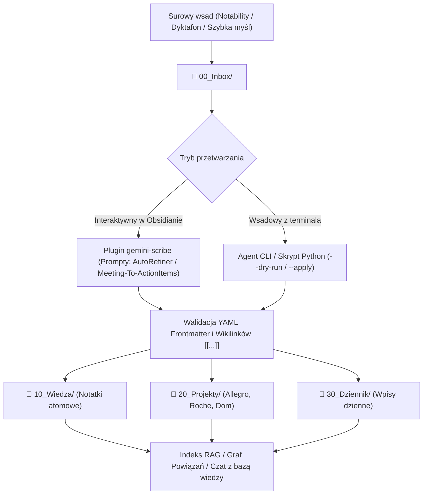

# Projekt Techniczny i Architektura (`design.md`): Agentowe Zarządzanie Wiedzą w Obsidianie

**Kod Zmiany**: `obsidian-agentic-pkm`  
**Data**: 18 Października 2026  
**Źródła**: [`explore/001-obsidian-agentic-pkm-01.md`](file:///Users/pawel/git/gen-ai-orchestrator/openspec/changes/obsidian-agentic-pkm/explore/001-obsidian-agentic-pkm-01.md), [`proposal.md`](file:///Users/pawel/git/gen-ai-orchestrator/openspec/changes/obsidian-agentic-pkm/proposal.md)

---

## 1. Cel i Zakres Architektury (Context & Goals)

Celem projektu jest przekształcenie lokalnego skarbca Obsidian (`/Users/pawel/Documents/Pawel-personal`, obecnie ~75 nieustrukturyzowanych notatek) w **Agentowy System Zarządzania Wiedzą (Personal OS)**, w którym agenty AI (wbudowany plugin `gemini-scribe` v4.11.0 oraz zewnętrzne agenty CLI takie jak Antigravity / skrypty Python) operują na plikach Markdown w sposób bezpieczny, deterministyczny i audytowalny.

**Główne założenia:**
- **Zero utraty danych i nieniszcząca migracja (Non-Destructive Enrichment)**: Żadna istniejąca treść notatki ani załącznik z Notability nie może zostać nadpisana ani skrócona bez jawnej zgody.
- **Lokalna własność danych (Local-First)**: Wszystkie notatki pozostają czystymi plikami `.md` na dysku lokalnym.
- **Podwójny interfejs agentowy**:
  1. *Wewnątrz Obsidiana*: interaktywne prompty i czat RAG przez `gemini-scribe`.
  2. *Z poziomu terminala (CLI)*: operacje wsadowe, audyt spójności grafu i automatyczne tagowanie YAML.

---

## 2. Przegląd Komponentów i Przepływu Danych (System Architecture & Flow)



### Struktura Katalogów Skarbca (`/Users/pawel/Documents/Pawel-personal`)
- `00_Inbox/` – bufor wejściowy dla nieprzetworzonych notatek.
- `10_Wiedza/` – pojęcia atomowe, definicje, architektura, referencje techniczne.
- `20_Projekty/` – notatki przypisane do konkretnych inicjatyw zawodowych i prywatnych (`Allegro`, `Roche`, `Dzieci`, `Zdrowie`, `Dom`).
- `30_Dziennik/` – notatki chronologiczne (migracja lub alias obecnego katalogu `dziennik/`).
- `90_System/Szablony/` – szablony Markdown dla nowych wpisów.
- `gemini-scribe/Prompts/` – repozytorium promptów agentowych wywoływanych bezpośrednio z edytora Obsidian.

---

## 3. Kontrakty Danych i Schemat Frontmatter YAML (Schemas & Models)

Każda ustrukturyzowana notatka w skarbcu musi rozpoczynać się blokiem YAML Frontmatter zgodnym z Obsidian Properties:

```yaml
---
typ: notatka # Dozwolone wartości: inbox | pojęcie | projekt | spotkanie | dziennik
obszar: "[[Allegro]]" # Wikilink do głównego obszaru/projektu (w cudzysłowie dla pełnej zgodności z parserem YAML)
tagi:
  - pkm
  - architektura
stworzono: 2026-10-10 # Format ISO YYYY-MM-DD
ostatnia_modyfikacja: 2026-10-18 # Format ISO YYYY-MM-DD
status: aktywne # Dozwolone wartości: szkic | aktywne | zarchiwizowane
---
```

> [!IMPORTANT]
> W YAML zapis `[[Projekt]]` bez cudzysłowów jest interpretowany przez standardowe parsery YAML jako zagnieżdżona tablica `[["Projekt"]]`. Aby zachować pełną kompatybilność zarówno z Obsidian Properties, jak i zewnętrznymi skryptami Python (`PyYAML`), wszelkie wartości zawierające `[[...]]` w polach skalarnych **muszą być ujęte w cudzysłowy**: `"[[Projekt]]"`.

---

## 4. Wybory Architektoniczne i Trade-offy (Architectural Trade-offs)

| Wariant | Zalety | Wady / Ryzyka | Decyzja |
| --- | --- | --- | --- |
| **Wariant A: Konfiguracja narzędzi i promptów (`gemini-scribe` + struktura folderów)** | Natychmiastowa gotowość do pracy z nowymi notatkami; zero ryzyka uszkodzenia starych plików. | Stare ~75 notatek pozostaje bez metadanych YAML do czasu ich ręcznego lub wsadowego przetworzenia. | **Krok 1 (Rekomendowany start)** |
| **Wariant B: Pilotaż na 2–3 żywych notatkach** | Empiryczna weryfikacja jakości promptów (`AutoRefiner`, `Meeting-To-ActionItems`) na rzeczywistych notatkach użytkownika przed automatyzacją. | Wymaga krótkiej sesji przeglądowej z użytkownikiem. | **Krok 2 (Walidacja jakości)** |
| **Wariant C: Wsadowy skrypt migracyjny Python dla wszystkich 75 notatek** | 100% pokrycia metadanymi YAML w całym skarbcu w kilka sekund. | Ryzyko błędnej klasyfikacji tematycznej przez LLM lub naruszenia specyficznego formatowania eksportów z Notability bez nadzoru. | **Krok 3 (Wyłącznie w trybie dwufazowym: `dry-run` raport -> zatwierdzenie -> `apply`)** |

---

## 5. Obsługa Sytuacji Awaryjnych i Krawędziowych (Edge Cases & Error Handling)

1. **Kolizja składni YAML z Wikilinkami Obsidiana**:
   - Skrypt wsadowy oraz prompty w `gemini-scribe` muszą wymuszać zapis `"[[Nazwa]]"` w cudzysłowie.
2. **Notatki wyeksportowane z Notability / zawierające załączniki PDF i obrazy**:
   - Przenoszenie plików pomiędzy folderami z poziomu zewnętrznego skryptu poza Obsidianem może zerwać relatywne linki do obrazów/PDF, jeśli nie są używane unikalne ścieżki w skarbcu. Dlatego zmiana lokalizacji istniejących plików powinna odbywać się albo wewnątrz Obsidiana (który automatycznie aktualizuje linki), albo skryptem aktualizującym referencje `![[...]]`.
3. **Halucynacje linków (`[[Nieistniejące Pojęcie]]`)**:
   - Prompt `AutoRefiner.md` powinien rozróżniać istniejące notatki w skarbcu od nowych propozycji pojęć, aby nie zaśmiecać grafu wiedzy dziesiątkami pustych węzłów (dead links).
4. **Kopia zapasowa przed operacjami wsadowymi**:
   - Przed uruchomieniem jakiejkolwiek operacji wsadowej (Wariant C) na `/Users/pawel/Documents/Pawel-personal`, wymagany jest snapshot katalogu (np. kopia `.tar.gz` lub commit Git wewnątrz skarbca).
